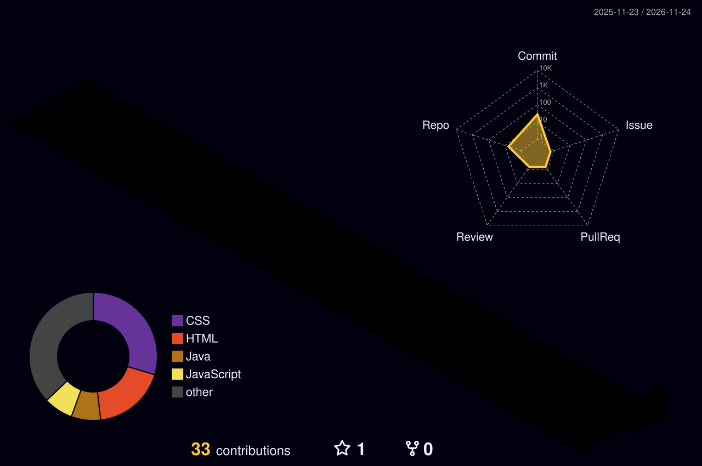

<div align="center">


<a href="https://github.com/CodePabloH">
  
</a>

<br/>


<br/>


</div>

<br/>


## 💜 Quem sou eu

<div align="center">

```ansi
╔═══════════════════════════════════════════════════╗
║  pablo@github  ~  whoami                          ║
╠═══════════════════════════════════════════════════╣
║  👤 Nome ........ Pablo Henrique                  ║
║  🎓 Curso ....... Engenharia de Software (2º per.)║
║  🧠 Curioso por . Inteligência Artificial         ║
║  📈 Hobby ....... Análise de Dados                ║
║  📍 Local ....... Goiânia, GO                     ║
║  ⚡ Lema ........ Consistência vence talento      ║
╚═══════════════════════════════════════════════════╝
```

</div>


## 🧰 Stack

<div align="center">


<br/><br/>

**🌱 Em aprendizado**


</div>


## 🗺️ Roadmap

<div align="center">

| Etapa | Status |
|:---|:---:|
| Lógica de programação | ✅ |
| HTML e CSS básico | ✅ |
| Git e GitHub | ✅ |
| Java (faculdade) | 🟣 em andamento |
| JavaScript mais a fundo | ⬜ |
| Python para análise de dados | ⬜ |
| Pandas, NumPy e visualização | ⬜ |
| Banco de dados (SQL) | ⬜ |
| Primeiros projetos de Machine Learning | ⬜ |

</div>


## 🌌 Minhas contribuições em 3D

<div align="center">



</div>

## 🐍 Cobrinha comendo meus commits

<div align="center">


</div>


## 📊 Estatísticas

<div align="center">


<br/><br/>


<br/><br/>


</div>


## 🏆 Conquistas

<div align="center">


</div>

## 🎯 Metas

- 🚀 Publicar meu primeiro projeto de análise de dados
- 🧠 Entender como funciona um modelo de Machine Learning simples
- 🐍 Dominar o básico de Python com Pandas
- 💪 Manter commits toda semana

<br/>

<div align="center">


</div>
