<div align="center">



<a href="https://github.com/CodePabloH">
  
</a>

<br/>


<br/>


</div>

<br/>

## 🧬 &nbsp;Quem sou eu

Estudante do **2º período de Engenharia de Software**, em Goiânia. Sou movido por **curiosidade**: gosto de entender como as coisas funcionam, da inteligência artificial aos números por trás de qualquer fenômeno. Estudo por prazer, e **alta performance** pra mim é método, constância e revisão.

<div align="center">

| 🤖 **IA** | 📊 **Dados** | 🔬 **Ciência** | 💻 **Tecnologia** | ⚡ **Performance** |
|:---:|:---:|:---:|:---:|:---:|
| Como máquinas aprendem | Achar padrões e insights | Método e curiosidade | Construir soluções | Foco, rotina, constância |

</div>

<br/>

## ⚡ &nbsp;Protocolo de alta performance

```yaml
rotina:
  foco: blocos de estudo sem distração (Pomodoro)
  revisao: espaçada, para fixar de verdade
  pratica: aprender codando, não só lendo
  registro: tudo versionado no Git
mentalidade:
  - consistência vence intensidade
  - errar rápido, aprender mais rápido
  - todo dia, um pouco melhor
```

<br/>

## 🧰 &nbsp;Stack

<div align="center">


</div>

<div align="center">



</div>

<br/>

## 🧠 &nbsp;Trilha de IA & Dados

```text
🎯 Objetivo: construir minha base para IA e Ciência de Dados
│
├── ✅ Lógica de programação
├── 🟣 Python
│   ├── ⬜ Pandas e NumPy
│   └── ⬜ Visualização (Matplotlib / Seaborn)
├── ⬜ Estatística básica
├── ⬜ SQL
├── ⬜ Primeiros projetos de análise de dados
└── ⬜ Machine Learning
    ├── ⬜ Regressão e classificação
    └── ⬜ Redes neurais (conceitos)
```

<br/>

## 📊 &nbsp;Estatísticas

<div align="center">


<br/><br/>


<br/><br/>


</div>

<br/>

## 🐍 &nbsp;Cobrinha comendo meus commits

<div align="center">


</div>

<br/>

## 🏆 &nbsp;Conquistas

<div align="center">


</div>

<br/>

<div align="center">


</div>
